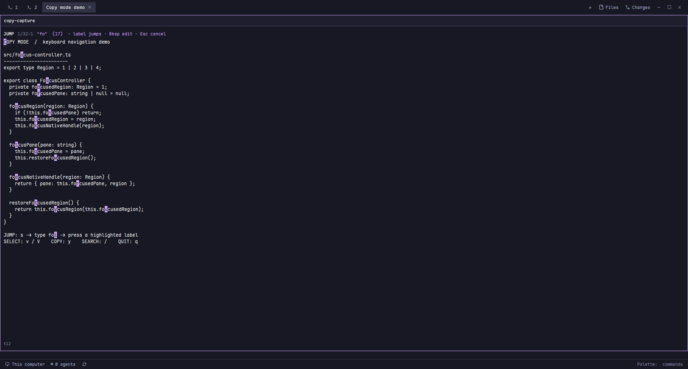

> **已迁移 / Moved:** 此 mod 现统一维护于 [herdr-mods/copy-mode](https://github.com/ParadiseWitch/herdr-mods/tree/main/copy-mode)。请从新仓库安装和获取更新。

# Copy Mode for Herdr

Vim 风格终端复制模式：全键盘移动、智能大小写搜索、字符/整行选择，以及带标签的 **Jump 跳转模式**。



This is a real, unedited `herdr-app shot` screenshot in Jump mode, using fictional code from a dedicated demo terminal. The highlighted lowercase labels are native UI elements, not added to the image.

## Install

Tested on Windows with Herdr 0.1.11 and herdr-core. Clipboard output currently requires Windows PowerShell (`powershell`) on PATH.

Copy `mods/copy-mode` into your Herdr app home; do not overwrite an existing mod without reviewing/backing it up. Merge the bundled `keys.json` into your bindings after checking conflicts. Ctrl+Shift+Y opens the overlay; the `mod:copy-mode` Escape binding lets Escape cancel the native search input too. The mod also works with a prefix menu that calls `mod.open:copy-mode`.

Focus a terminal, then run:

```powershell
herdr-app do mod.open --name copy-mode
```

## Keys

- `hjkl` / arrows; `w/e/b` and `W/E/B`; `0/$`; `g/G`; `{ / }`; Ctrl+D/U and PageUp/Down.
- `/` searches; Enter accepts, `n/N` jumps through matches. Lowercase queries ignore case; uppercase makes them case-sensitive.
- `s` enters Jump. Type two or more characters to see labels after visible matches, then press a label. A unique match jumps automatically. Backspace edits; Escape cancels. Labels exclude the character immediately following a match to avoid accidental jumps while refining.
- `v` selects characters; `V` selects lines. `y` or Enter copies to the system clipboard and closes. With no selection, it copies the current line.
- Escape clears search/jump/selection first, then closes; `q` closes.

## Access

The mod reads up to 2000 lines from the focused core terminal using `hc read`, including history. This is a snapshot, not a live terminal. If no terminal is focused, it may reuse the last target saved in shared state. Remote terminal reads use the configured core connection. It writes selected text to a temporary file under the app home, invokes PowerShell Set-Clipboard, then removes that file on success or failure. It publishes a local keyboard-capture mark while its overlay is open. It has no direct web fetch, analytics or upload function.

Only mod source, documentation and the sanitized screenshot are published. Personal terminal buffers, local state, credentials, demo scripts and personal paths are excluded.
