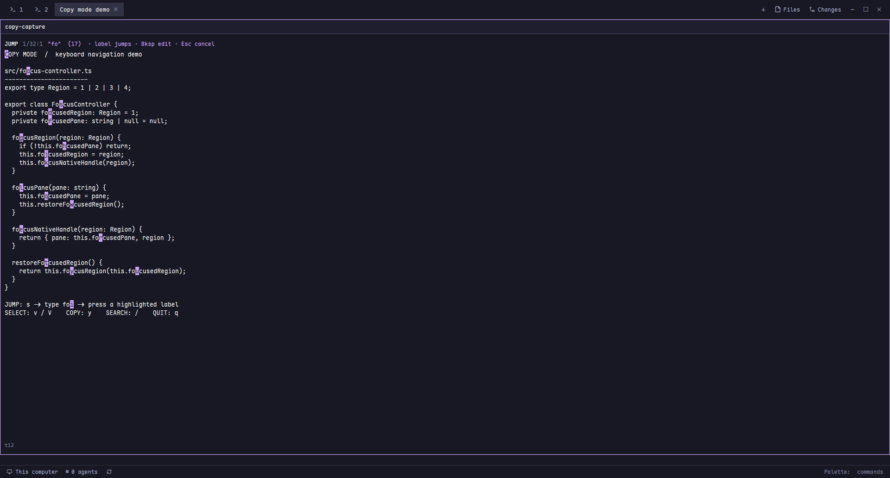

# Copy Mode

A native Vim-style cursor and selection view over a terminal snapshot, with incremental search and labeled Jump navigation. The screenshot is a real Herdr capture in Jump mode displaying fictional demo terminal output.

## What you see

The overlay fills 90% of window width and 85% of height. It follows the Herdr theme, uses an 8px inset, a 26px header, 18px terminal rows at 13px monospace text, and a 22px footer. The header shows NORMAL, SEARCH, JUMP, VISUAL or V-LINE, the cursor position and mode hints. The footer shows the terminal address and any status. Accent colors mark cursor and jump labels; search matches and selected glyphs use theme backgrounds. Text is the terminal's plain snapshot, not its original ANSI colors.

## How it behaves

Read screen and history once, up to 2000 lines. Motions keep the cursor visible. Search uses smartcase. Jump searches only visible lines: s starts it, typed characters refine it, and at two characters labels are assigned from lowercase letters excluding immediate continuation characters. One match jumps automatically; a label jumps, Backspace edits, Escape cancels. At most 26 labels, fewer when continuation characters are reserved. v selects inclusive glyphs, V selects full lines, y or Enter copies and closes. No selection means current line. Escape clears a mode before closing; q closes. Arrow and Vim motions, words, paragraph, start/end and page controls work entirely from the keyboard. Mouse click focuses the view; mouse drag selection is not implemented. Agent working/blocked/done/idle states do not alter the snapshot or UI.

## Built from

One gpui-kit View in mods/copy-mode/main.js, a mod.json declaring an overlay window, and keys.json with opener and search Escape binding. Native InputState/Input owns search typing; focus handle owns navigation. Uses herdr focused/panes/shared/nextCommand for targeting and capture, hc read for the snapshot, fs write/unlink plus exec powershell Set-Clipboard for copying, notifications and closeOverlay. The copy-mode.target shared value remembers the last target. No shipped layout or mod is edited.

## Watch out

Windows clipboard command is required; do not claim macOS/Linux clipboard support. Snapshot limit is 2000 lines; changed terminal output is not refreshed. Unicode selection indexes glyphs. Native focus must begin after root layout, not in init/headless check, and must not be reasserted by a fixed 400ms timer. A native search input needs its Escape mod binding. Copies of terminal text belong only in a temporary local file and must be deleted even after clipboard failure. Close only clears its own capture mark. Never publish real buffers, target state or private paths.

## Done when

herdr-app check mods/copy-mode passes. Jump shows labels for a multi-match two-character query; labels jump to their matches, and a single refined match jumps automatically. Search and selection work with Unicode. Character/line selection produces the expected text. Clipboard command reports failure visibly and removes its temporary file. The preview is a real Jump-mode screenshot with no private content; the public package contains only source, documentation and that image.
